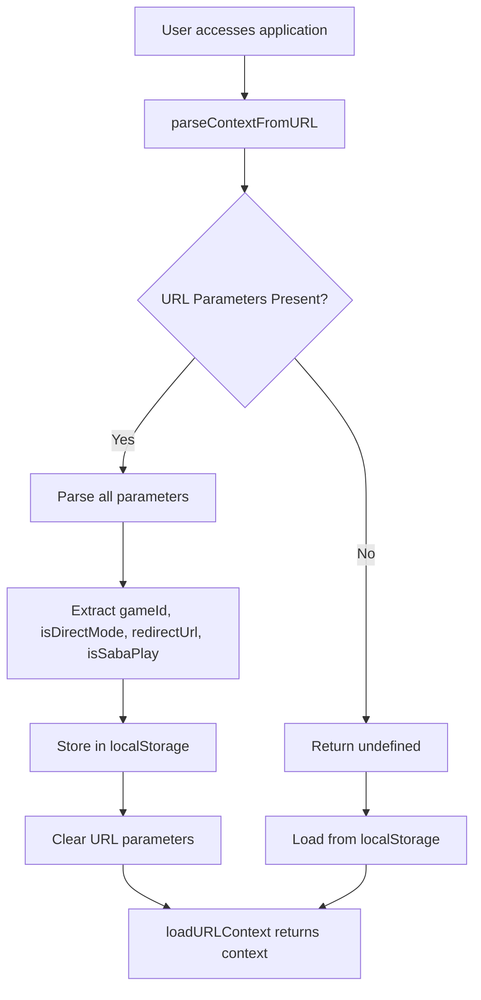
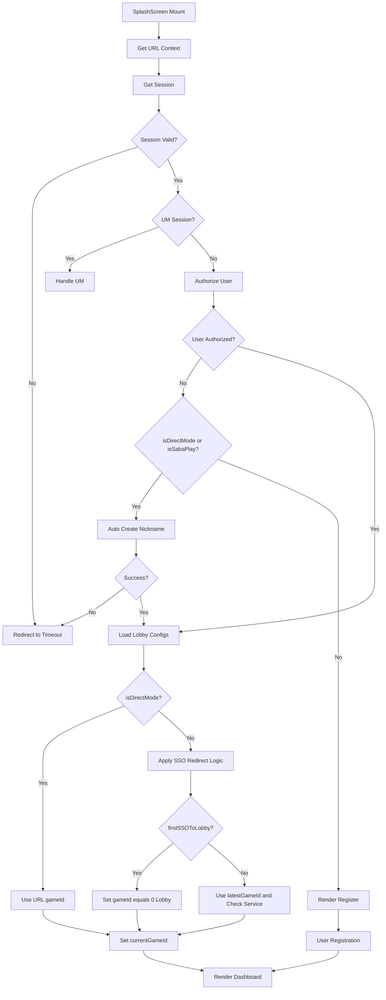
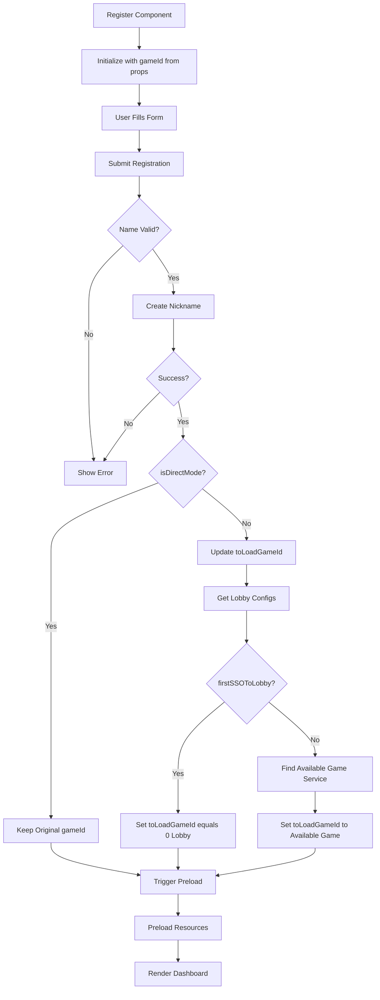
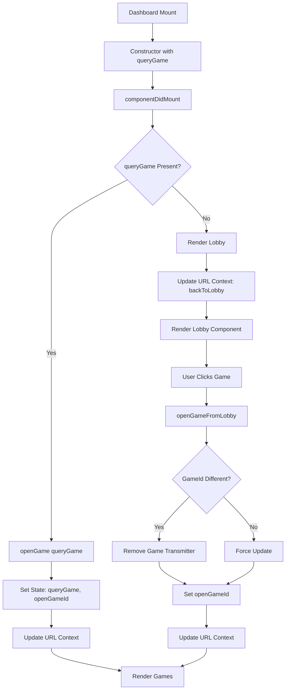
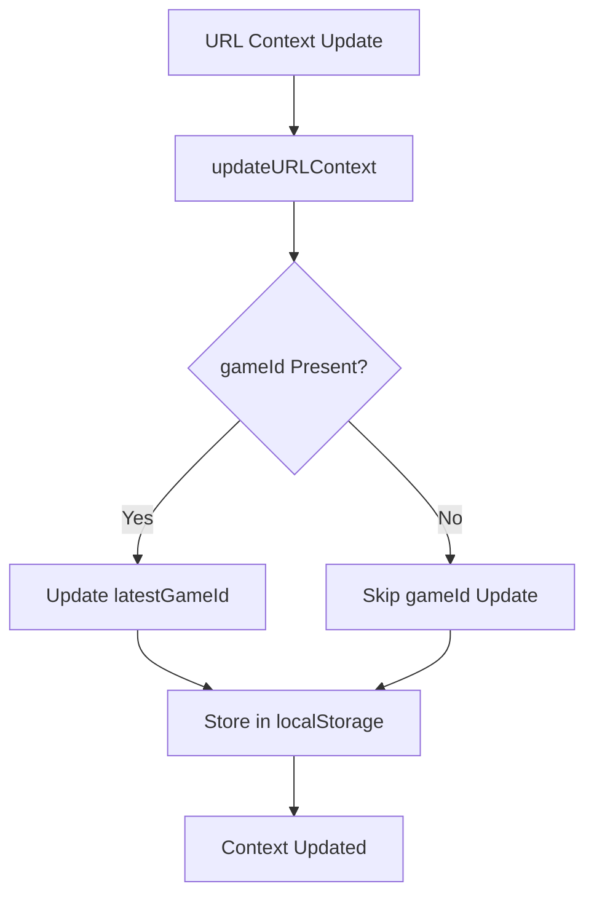
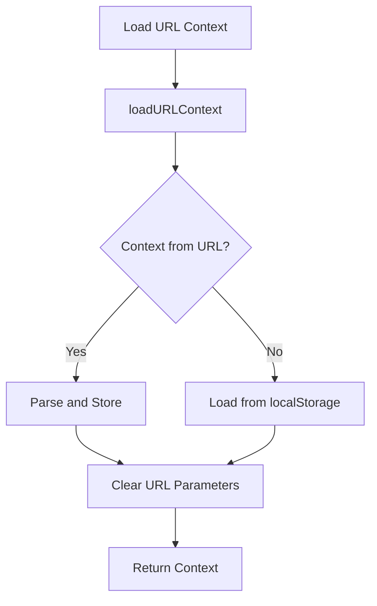

# URL Context Analysis: First Login to Lobby Flow

## Overview

This document provides a comprehensive analysis of the URL context parameters (`isDirectMode`, `redirectUrl`, `isSabaPlay`, `gameId`) and their critical roles in the first login to lobby flow of the gaming application.

## URL Context Parameters

### 1. `gameId` (number)

**Purpose**: Determines which game to load or whether to show the lobby
**Source**: URL parameter `?gameId=X`
**Default**: `0` (lobby mode)

**Values**:

-   `0`: Lobby mode (no specific game)
-   `> 0`: Specific game ID to load
-   `-1`: Initial state (not yet determined)

### 2. `isDirectMode` (boolean)

**Purpose**: Controls whether the user should be taken directly to a specific game or follow SSO redirect logic
**Source**: URL parameter `?ref=true`
**Default**: `false`

**Behavior**:

-   `true`: Skip SSO redirect logic, use URL gameId directly
-   `false`: Apply SSO redirect logic, may change gameId based on business rules

### 3. `redirectUrl` (string)

**Purpose**: Base64 encoded URL to redirect to after game completion or back to lobby action
**Source**: URL parameter `?rurl=<base64-encoded-url>` (only when `isDirectMode=true`)
**Default**: `""` (empty string)

**Usage**: Used in `backToRedirectUrl` function to handle post-game navigation

### 4. `isSabaPlay` (boolean)

**Purpose**: Identifies if the user is coming from SabaPlay platform
**Source**: URL parameter `?op=SP`
**Default**: `false`

**Behavior**:

-   `true`: Triggers auto nickname creation (same as Direct Mode)
-   `false`: Normal registration flow

## URL Context Parsing Flow

```typescript
// From url-context.ts
export function parseContextFromURL(): URLContextModel | undefined {
    const params = new URLSearchParams(globalThis.location?.search);

    const token = params.get("token");
    const language = params.get("lang");
    const gameId = Number(params.get("gameId") || 0);
    const isDirectMode = !!params.get("ref");
    const redirectUrl = isDirectMode ? params.get("rurl") : "";
    const isSabaPlay = params.get("op") === "SP";

    return {
        token,
        language,
        gameId,
        isDirectMode,
        redirectUrl,
        firstSSOToLobby: true,
        isSabaPlay,
    };
}
```

## Complete First Login to Lobby Flow

### 1. Initial URL Context Loading



### 2. SplashScreen Initialization Flow



### 3. Registration Flow (Register Component)



### 4. Dashboard Rendering Logic



## Critical Decision Points

### 1. Direct Mode vs Non-Direct Mode

**Direct Mode (`isDirectMode = true`)**:

-   Uses URL `gameId` directly without modification
-   Skips SSO redirect logic
-   Triggers auto nickname creation for unauthorized users
-   Used for direct game access scenarios

**Non-Direct Mode (`isDirectMode = false`)**:

-   Applies SSO redirect logic
-   May change `gameId` based on business rules
-   Shows registration form for unauthorized users
-   Used for normal SSO flows

### 2. SabaPlay Integration (`isSabaPlay = true`)

**Behavior**:

-   Triggers auto nickname creation (same as Direct Mode)
-   Determined by URL parameter `op=SP`
-   Used for SabaPlay platform integration

### 3. First SSO to Lobby Logic (`firstSSOToLobby = true`)

**Business Requirement**: Redirect to lobby instead of specific game

-   **When `true`**: Sets `gameId = 0` (lobby mode)
-   **When `false`**: Uses `latestGameId` from localStorage and checks service availability

### 4. Game Service Availability Check

**Process**:

1. Get enabled game settings from lobby configs
2. Check if current `gameId` is available
3. If not available, find first available game service
4. Set `toLoadGameId` to available game

## URL Context State Management

### Context Storage Flow



### Context Retrieval Flow



## Common Flow Scenarios

### Scenario 1: Direct Game Access

```
URL: ?gameId=123&ref=true&rurl=<base64-url>
Flow: URL → SplashScreen → Auto Create Nickname → Dashboard → Game 123
```

### Scenario 2: Lobby Access (First SSO)

```
URL: ?gameId=0 (or no gameId)
Flow: URL → SplashScreen → Register → Dashboard → Lobby
```

### Scenario 3: SabaPlay Integration

```
URL: ?gameId=123&op=SP
Flow: URL → SplashScreen → Auto Create Nickname → Dashboard → Game 123
```

### Scenario 4: Normal SSO with Game Redirect

```
URL: ?gameId=123
Flow: URL → SplashScreen → Register → Dashboard → Available Game
```

## Key State Variables

### SplashScreen State:

-   `currentGameId`: Final gameId to load
-   `gameId`: Original URL gameId
-   `latestGameId`: From localStorage

### Register State:

-   `toLoadGameId`: GameId to pass to Dashboard
-   `gameId`: From props (original URL gameId)

### Dashboard State:

-   `queryGame`: GameId from props
-   `openGameId`: Currently open game
-   `gameTransmitters`: Active game connections

## Error Handling and Edge Cases

### 1. Invalid gameId

-   Falls back to `gameId = 0` (lobby mode)
-   Logs error for debugging

### 2. Service Unavailable

-   Searches for alternative available games
-   Falls back to lobby if no games available

### 3. Authorization Failure

-   Redirects to timeout page
-   Clears session data

### 4. Network Errors

-   Retries with exponential backoff
-   Shows user-friendly error messages

## Analytics and Tracking

### SSO Method Tracking:

```typescript
// From analytic-helper.ts
static login(urlContext: URLContextModel) {
    let ssoMethod = "SSO_To_Lobby";
    if (urlContext.isDirectMode) {
        ssoMethod = `SSO_Direct_Mode_To_Game`;
    } else if (urlContext.gameId) {
        ssoMethod = `SSO_To_Game`;
    }

    AnalyticsHelper.ssoContext = {
        ssoMethod,
        gameId: urlContext.gameId,
        language: urlContext.language,
    };
}
```

## Testing Considerations

### Test Cases to Cover:

1. **Direct Mode Scenarios**:

    - Direct game access with valid gameId
    - Direct mode with invalid gameId
    - Direct mode with unauthorized user

2. **SabaPlay Scenarios**:

    - SabaPlay integration with auto nickname creation
    - SabaPlay with different gameIds

3. **SSO Redirect Scenarios**:

    - First SSO to lobby
    - SSO with game redirect
    - Service availability checks

4. **Edge Cases**:
    - No URL parameters
    - Invalid URL parameters
    - Network failures
    - Session timeouts

## Conclusion

The URL context parameters (`isDirectMode`, `redirectUrl`, `isSabaPlay`, `gameId`) play critical roles in determining the user's journey from first login to lobby/game. Understanding these parameters and their interactions is essential for:

-   Debugging user flow issues
-   Implementing new features
-   Maintaining backward compatibility
-   Ensuring proper analytics tracking
-   Testing all possible scenarios

The flow is designed to handle various integration scenarios while maintaining a consistent user experience across different platforms and access methods.
