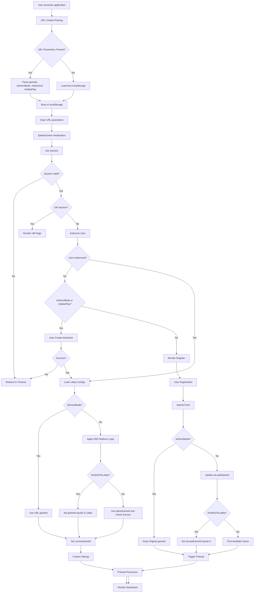
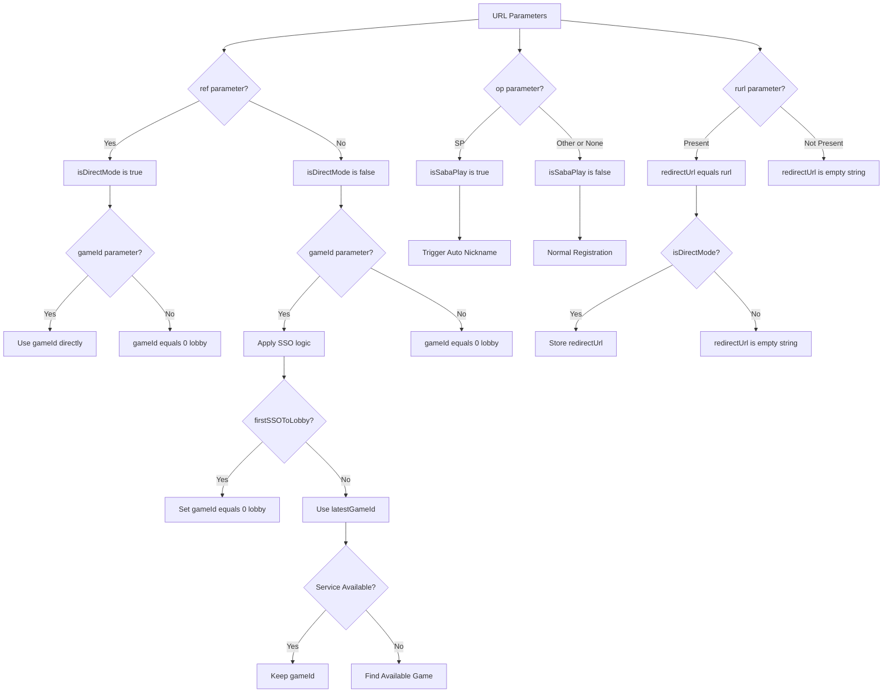
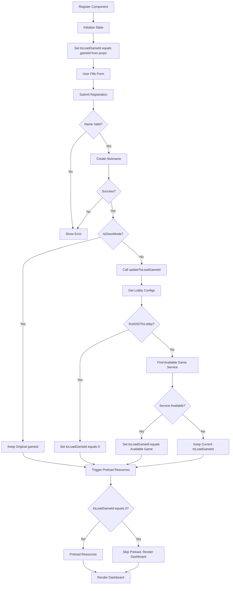
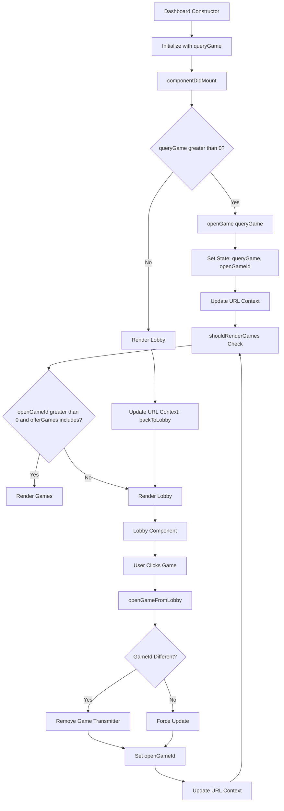
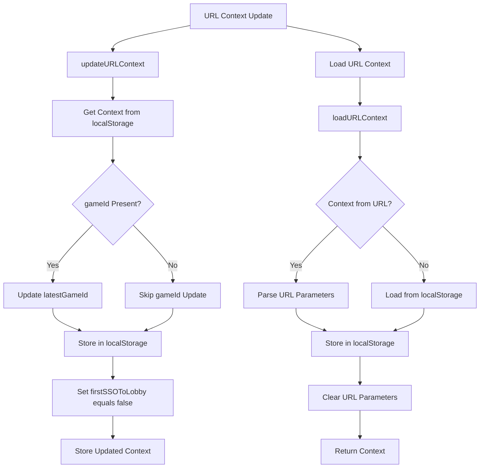
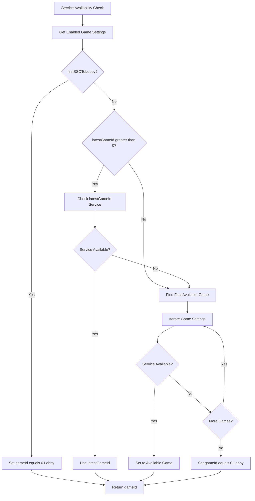
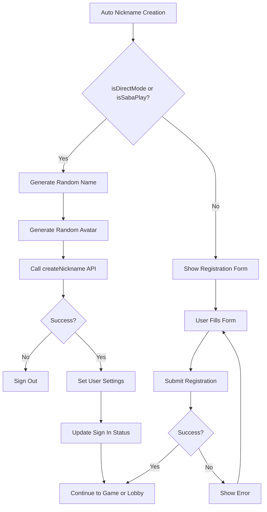
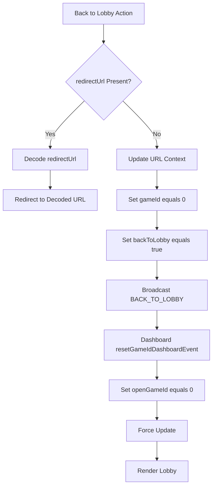
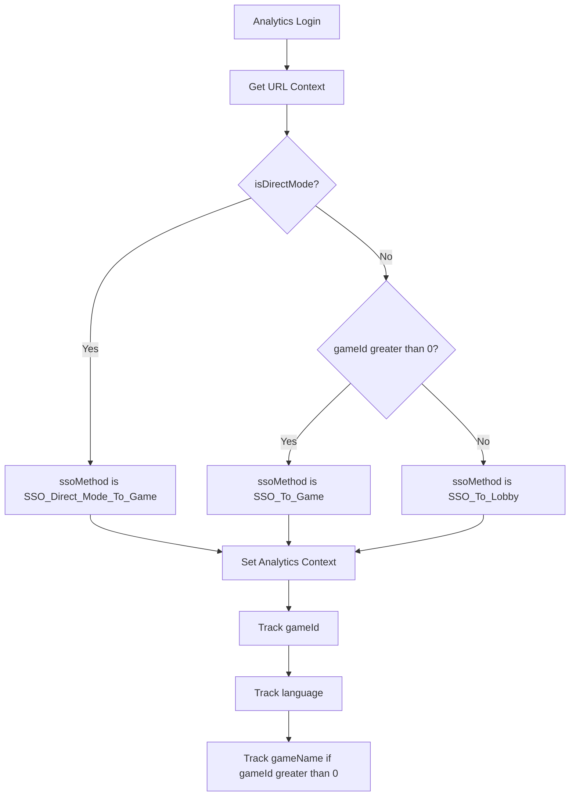
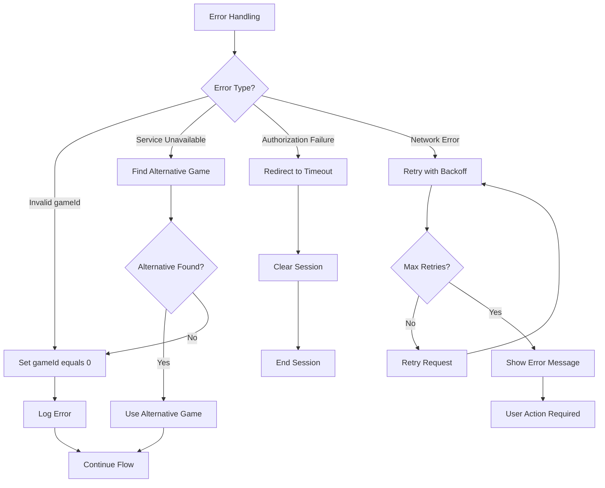

# URL Context Flow Diagrams

## 1. Complete First Login to Lobby Flow

## 2. URL Context Parameter Decision Tree

## 3. Registration Flow Decision Matrix

## 4. Dashboard Rendering Logic Flow

## 5. URL Context State Management Flow

## 6. Service Availability Check Flow

## 7. Auto Nickname Creation Flow

## 8. Back to Lobby Flow

## 9. Analytics Tracking Flow

## 10. Error Handling Flow

These diagrams provide a comprehensive visual representation of how the URL context parameters interact throughout the first login to lobby flow, helping developers understand the complex decision-making logic and state management involved in the application.
