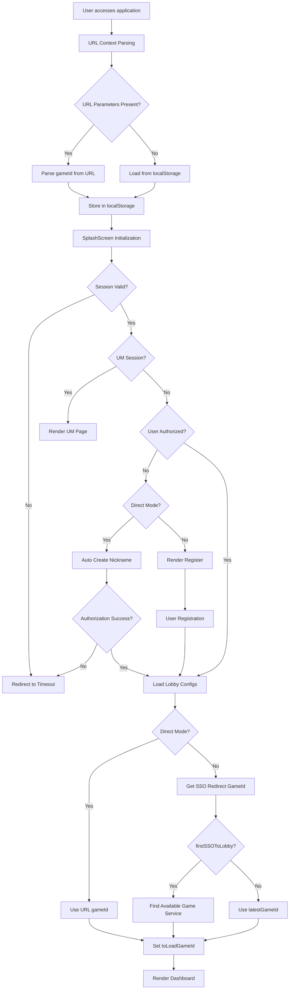
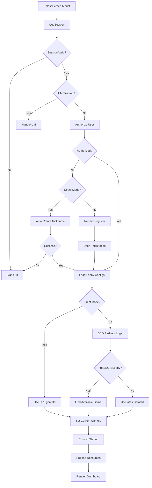
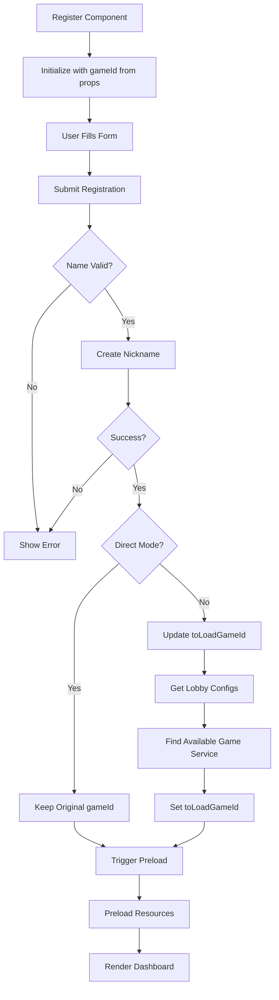
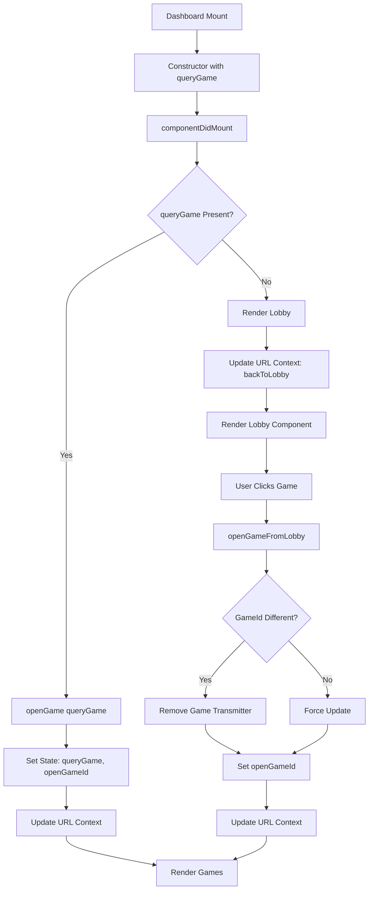
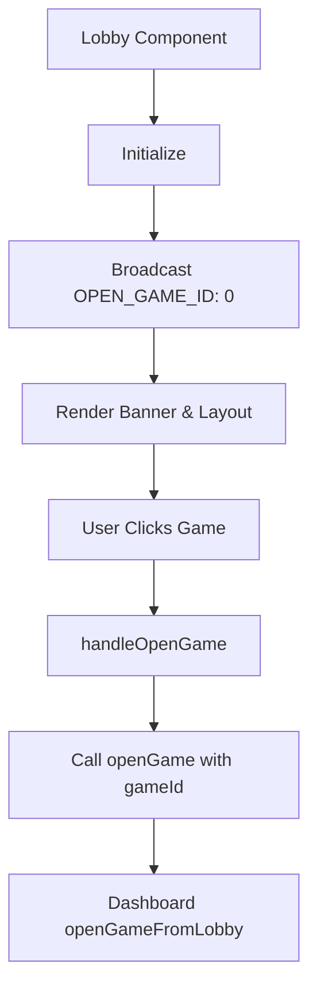
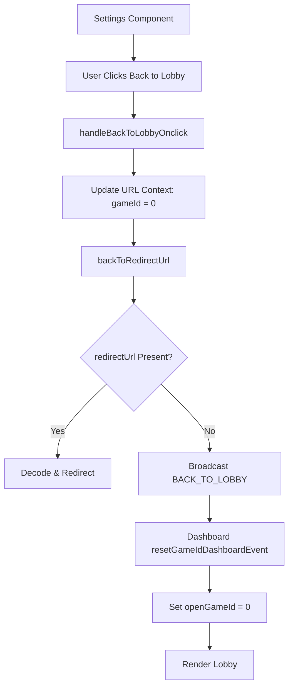
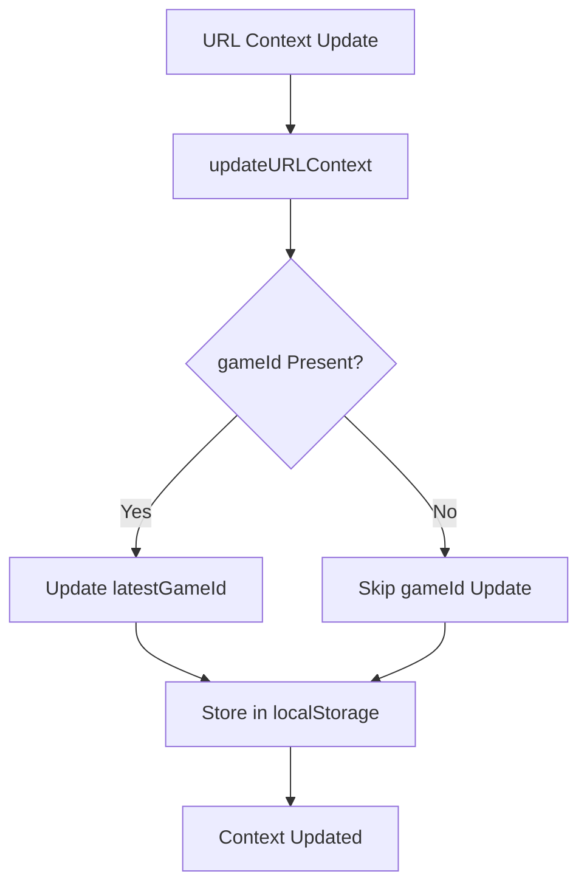

# Game ID Flow Workflow Analysis

## Overview

This document outlines the complete workflow for how `gameId` is handled throughout the application, from initial URL parsing to game selection and navigation.

## 1. Initial Application Load Flow



## 2. Game ID Sources and Priority

### Priority Order:

1. **URL Parameter** (`?gameId=X`) - Highest priority
2. **Direct Mode** - Uses URL gameId directly
3. **SSO Redirect Logic** - For non-direct mode with firstSSOToLobby
4. **Latest Game ID** - From localStorage
5. **Available Game Service** - First available game from lobby configs
6. **Default (0)** - Lobby mode

### URL Context Parsing:

```javascript
// From URL parameters
gameId = Number(params.get("gameId") || 0);
isDirectMode = !!params.get("ref");
redirectUrl = isDirectMode ? params.get("rurl") : "";
```

## 3. SplashScreen Component Flow



## 4. Register Component Flow



## 5. Dashboard Component Flow



## 6. Lobby Component Flow



## 7. Settings Component Flow



## 8. URL Context Management



## 9. Key State Variables

### SplashScreen State:

-   `currentGameId`: Final gameId to load
-   `gameId`: Original URL gameId
-   `latestGameId`: From localStorage

### Register State:

-   `toLoadGameId`: GameId to pass to Dashboard
-   `gameId`: From props (original URL gameId)

### Dashboard State:

-   `queryGame`: GameId from props
-   `openGameId`: Currently open game
-   `gameTransmitters`: Active game connections

## 10. Critical Decision Points

### 1. Direct Mode vs Non-Direct Mode:

-   **Direct Mode**: Uses URL gameId directly, no SSO redirect logic
-   **Non-Direct Mode**: Applies SSO redirect logic, may change gameId

### 2. firstSSOToLobby Logic:

-   **True**: Search for available game services
-   **False**: Use latestGameId from localStorage

### 3. Game Service Availability:

-   Check each enabled game setting for service availability
-   Select first available game if current game unavailable

### 4. Authorization Flow:

-   **Authorized**: Proceed to game/lobby
-   **Not Authorized + Direct Mode**: Auto-create nickname
-   **Not Authorized + Non-Direct Mode**: Show registration

## 11. Console Log Analysis Points

### Key Log Patterns to Monitor:

1. `[URLContext]` - URL parsing and context updates
2. `[SplashScreen]` - Initialization and gameId determination
3. `[Register]` - Registration flow and gameId updates
4. `[Dashboard]` - Game opening and state management
5. `[Lobby]` - Lobby interactions and game selection
6. `[Settings]` - Back to lobby functionality

### Critical Log Messages:

-   `Final toLoadGameId` - Final gameId decision
-   `Rendering Dashboard with gameId` - Dashboard rendering
-   `openGame called with gameId` - Game opening
-   `updateURLContext called with` - Context updates

## 12. Common Flow Scenarios

### Scenario 1: Direct Game Access

```
URL: ?gameId=123&ref=true
Flow: URL → SplashScreen → Dashboard → Game 123
```

### Scenario 2: Lobby Access

```
URL: (no gameId)
Flow: URL → SplashScreen → Dashboard → Lobby → User selects game
```

### Scenario 3: New User Registration

```
URL: ?gameId=123
Flow: URL → SplashScreen → Register → Dashboard → Game 123
```

### Scenario 4: SSO Redirect

```
URL: (no gameId, firstSSOToLobby=true)
Flow: URL → SplashScreen → Find available game → Dashboard → Available game
```

This workflow analysis provides a comprehensive understanding of how gameId flows through the application, enabling better debugging and feature development.
