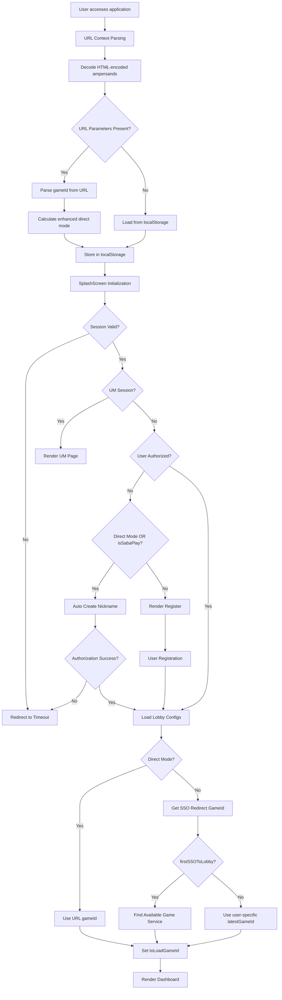
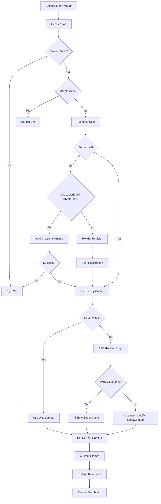
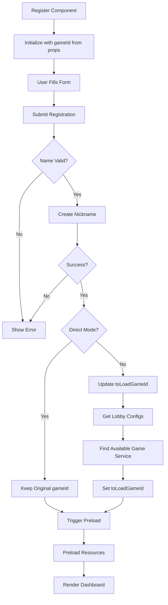
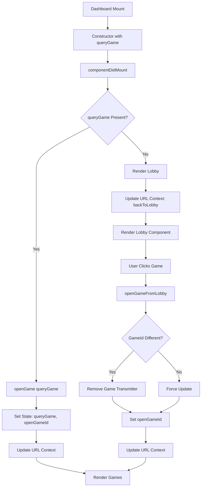
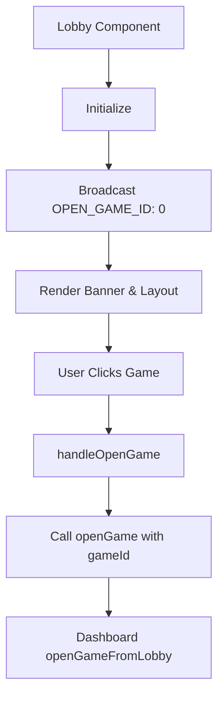
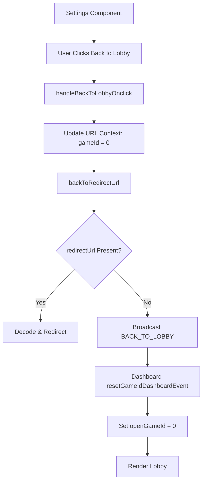
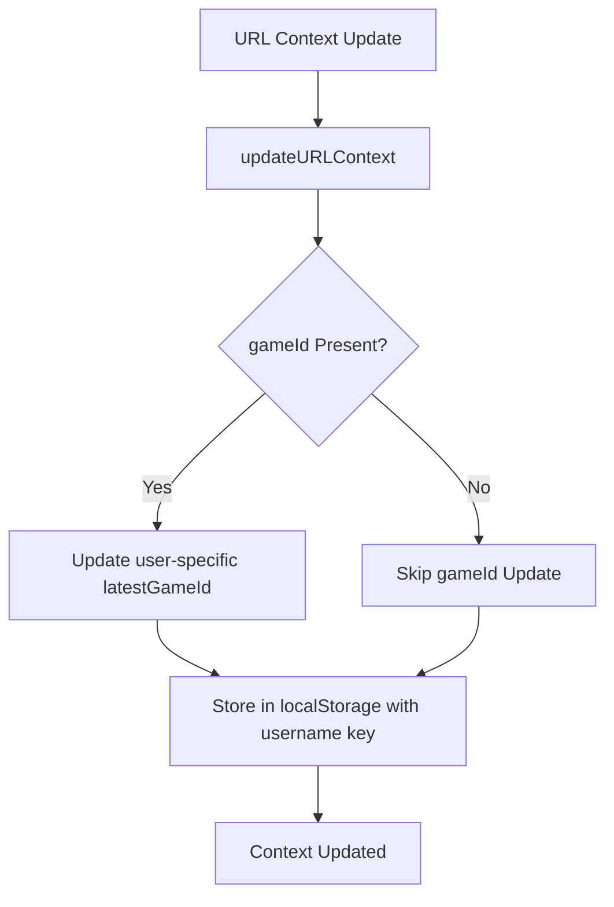

# Game ID Flow Workflow Analysis

## Overview

This document outlines the complete workflow for how `gameId` is handled throughout the application, from initial URL parsing to game selection and navigation.

## 🚨 Latest Updates (Latest Version)

### Key Improvements Applied

**1. User-Specific latestGameId Storage**

-   **Change**: `latestGameId` is now stored per user using username-based keys
-   **Implementation**: `getUserLatestGameId(username)` and `setUserLatestGameId(username, gameId)`
-   **Impact**: Prevents cross-user state leakage and ensures proper game tracking

**2. HTML-Encoded Ampersands Handling**

-   **Change**: URLs with `&amp;` are now properly decoded before parsing
-   **Implementation**: `searchParams.replace(/&amp;/g, '&')` before parsing
-   **Impact**: Fixes URL parsing issues in various integrations

**3. Enhanced Direct Mode Logic**

-   **Change**: Direct mode calculation now properly handles lobby access
-   **Implementation**: `effectiveRedirectUrl = gameId === 0 ? null : redirectUrl`
-   **Impact**: Allows lobby access even when `ref` and `rurl` parameters are present

## 1. Initial Application Load Flow



## 2. Game ID Sources and Priority

### Priority Order:

1. **URL Parameter** (`?gameId=X`) - Highest priority
2. **Direct Mode** - Uses URL gameId directly
3. **SSO Redirect Logic** - For non-direct mode with firstSSOToLobby
4. **User-Specific Latest Game ID** - From localStorage per user
5. **Available Game Service** - First available game from lobby configs
6. **Default (0)** - Lobby mode

### URL Context Parsing:

```javascript
// Enhanced URL parsing with HTML-encoded ampersands handling
let searchParams = globalThis.location?.search;

// Fix: Handle HTML-encoded ampersands
if (searchParams) {
    searchParams = searchParams.replace(/&amp;/g, "&");
}

const params = new URLSearchParams(searchParams);

// From URL parameters
gameId = Number(params.get("gameId") || 0);
ref = params.get("ref");
redirectUrl = params.get("rurl");
isSabaPlay = params.get("op") === "SP";

// Enhanced direct mode logic
effectiveRedirectUrl = gameId === 0 ? null : redirectUrl;
isDirectMode = !!(ref && effectiveRedirectUrl) || (isSabaPlay && gameId !== 0);
```

### User-Specific Storage:

```javascript
// User-specific latestGameId handling
const getUserSpecificGameId = (username: string): number => {
    if (!username) return 0;
    const key = `${localStorageKeys.latestGameId}_${username}`;
    return StorageHelper.get(key) || 0;
};

const setUserSpecificGameId = (username: string, gameId: number): void => {
    if (!username) return;
    const key = `${localStorageKeys.latestGameId}_${username}`;
    StorageHelper.set(key, gameId);
};
```

## 3. SplashScreen Component Flow



## 4. Register Component Flow



## 5. Dashboard Component Flow



## 6. Lobby Component Flow



## 7. Settings Component Flow



## 8. URL Context Management



## 9. Key State Variables

### SplashScreen State:

-   `currentGameId`: Final gameId to load
-   `gameId`: Original URL gameId
-   `latestGameId`: User-specific from localStorage

### Register State:

-   `toLoadGameId`: GameId to pass to Dashboard
-   `gameId`: From props (original URL gameId)

### Dashboard State:

-   `queryGame`: GameId from props
-   `openGameId`: Currently open game
-   `gameTransmitters`: Active game connections

## 10. Critical Decision Points

### 1. Direct Mode vs Non-Direct Mode:

-   **Direct Mode**: Uses URL gameId directly, no SSO redirect logic
-   **Non-Direct Mode**: Applies SSO redirect logic, may change gameId

### 2. isSabaPlay Logic:

-   **True**: Triggers auto nickname creation (same as Direct Mode)
-   **False**: Normal registration flow
-   **Note**: `isSabaPlay` is determined by URL parameter `op=SP`

### 3. firstSSOToLobby Logic:

-   **True**: Search for available game services
-   **False**: Use user-specific latestGameId from localStorage

### 4. Game Service Availability:

-   Check each enabled game setting for service availability
-   Select first available game if current game unavailable

### 5. Authorization Flow:

-   **Authorized**: Proceed to game/lobby
-   **Not Authorized + (Direct Mode OR isSabaPlay)**: Auto-create nickname
-   **Not Authorized + Non-Direct Mode + !isSabaPlay**: Show registration

### 6. User-Specific Storage:

-   **Isolation**: Each user has isolated game tracking
-   **Prevention**: Prevents cross-user state interference
-   **Fallback**: Uses global storage when username not available

## 11. Console Log Analysis Points

### Key Log Patterns to Monitor:

1. `[URLContext]` - URL parsing and context updates
2. `[SplashScreen]` - Initialization and gameId determination
3. `[Register]` - Registration flow and gameId updates
4. `[Dashboard]` - Game opening and state management
5. `[Lobby]` - Lobby interactions and game selection
6. `[Settings]` - Back to lobby functionality

### Critical Log Messages:

-   `Final toLoadGameId` - Final gameId decision
-   `Rendering Dashboard with gameId` - Dashboard rendering
-   `openGame called with gameId` - Game opening
-   `updateURLContext called with` - Context updates
-   `User-specific latestGameId` - User-specific storage operations

## 12. Common Flow Scenarios

### Scenario 1: Direct Game Access

```
URL: ?gameId=123&ref=d_direct
Flow: URL → SplashScreen → Dashboard → Game 123
```

### Scenario 2: Lobby Access

```
URL: (no gameId)
Flow: URL → SplashScreen → Dashboard → Lobby → User selects game
```

### Scenario 3: New User Registration

```
URL: ?gameId=123
Flow: URL → SplashScreen → Register → Dashboard → Game 123
```

### Scenario 4: SSO Redirect

```
URL: (no gameId, firstSSOToLobby=true)
Flow: URL → SplashScreen → Find available game → Dashboard → Available game
```

### Scenario 5: SabaPlay Auto Registration

```
URL: ?op=SP&gameId=123
Flow: URL → SplashScreen → Auto Create Nickname → Dashboard → Game 123
```

**Key Steps in SabaPlay Flow:**

1. `isSabaPlay = true` from URL parameter `op=SP`
2. User not authorized triggers auto nickname creation
3. Auto-generated nickname and avatar created
4. Direct navigation to game without registration form

### Scenario 6: HTML-Encoded URL (Fixed)

```
URL: ?token=test&amp;gameId=123&amp;op=SP
Flow: URL → SplashScreen → Auto Create Nickname → Dashboard → Game 123
```

**Key Steps in HTML-Encoded URL Flow:**

1. HTML-encoded ampersands are decoded before parsing
2. URL parameters are properly extracted
3. Normal flow continues with decoded parameters

### Scenario 7: User-Specific Storage (Fixed)

```
Multiple users accessing same application
Flow: Each user has isolated game tracking, no cross-user interference
```

**Key Steps in User-Specific Storage Flow:**

1. Each user's latestGameId is stored with username-based keys
2. Game tracking is isolated per user
3. No cross-user state leakage occurs

## 13. Recent Bug Fixes and Improvements

### Bug Fix 1: Cross-User latestGameId Interference - FIXED ✅

**Issue**: `latestGameId` was stored globally, causing cross-user interference when multiple users accessed the application.

**Root Cause**:

-   Global localStorage key used for all users
-   No user-specific isolation

**Fix Applied**:

-   **Storage Helper**: Added `getUserLatestGameId(username)` and `setUserLatestGameId(username, gameId)`
-   **Splash Screen**: Uses user-specific latestGameId instead of global one
-   **URL Context**: Stores and retrieves user-specific game IDs

**Impact**: Each user now has isolated game tracking, preventing cross-user interference.

### Bug Fix 2: HTML-Encoded Ampersands Breaking URL Parsing - FIXED ✅

**Issue**: URLs with `&amp;` (HTML-encoded ampersands) failed to parse correctly.

**Root Cause**:

-   URLSearchParams didn't handle HTML-encoded ampersands
-   Parsing failed for certain integration scenarios

**Fix Applied**:

-   **URL Context**: Added `searchParams.replace(/&amp;/g, '&')` before parsing
-   **Comprehensive Testing**: Verified all URL parameter combinations work

**Impact**: All URL parsing scenarios now work correctly, including HTML-encoded parameters.

### Bug Fix 3: Enhanced Direct Mode Logic - FIXED ✅

**Issue**: Direct mode calculation didn't properly handle lobby access scenarios.

**Root Cause**:

-   Direct mode logic didn't account for lobby access with `ref` and `rurl` parameters
-   `rurl` parameter was always considered for direct mode calculation

**Fix Applied**:

-   **URL Context**: Enhanced direct mode logic to ignore `rurl` when `gameId=0`
-   **Effective Redirect URL**: Set to `null` when accessing lobby to prioritize lobby access

**Impact**: Users can now access lobby properly even when `ref` and `rurl` parameters are present.

## 14. Testing Coverage

### Key Test Cases:

```typescript
it("should handle user-specific storage isolation", () => {
    const user1 = "user1";
    const user2 = "user2";
    const gameId1 = 123;
    const gameId2 = 456;

    setUserSpecificGameId(user1, gameId1);
    setUserSpecificGameId(user2, gameId2);

    expect(getUserSpecificGameId(user1)).toBe(gameId1);
    expect(getUserSpecificGameId(user2)).toBe(gameId2);
    expect(getUserSpecificGameId(user1)).not.toBe(getUserSpecificGameId(user2));
});

it("should handle HTML-encoded URLs correctly", () => {
    const searchParams = "?token=test&amp;gameId=123&amp;op=SP";
    const result = parseContextFromURL();
    expect(result?.token).toBe("test");
    expect(result?.gameId).toBe(123);
    expect(result?.isSabaPlay).toBe(true);
});

it("should calculate direct mode correctly with enhanced logic", () => {
    const testCases = [
        {
            params: { gameId: "0", ref: "true", rurl: "test" },
            expected: { isDirectMode: false, redirectUrl: null }, // rurl ignored when gameId=0
        },
        {
            params: { gameId: "123", ref: "true", rurl: "test" },
            expected: { isDirectMode: true, redirectUrl: "test" },
        },
        {
            params: { gameId: "123", op: "SP" },
            expected: { isDirectMode: true, redirectUrl: null }, // SabaPlay with gameId > 0
        },
        {
            params: { gameId: "0", op: "SP" },
            expected: { isDirectMode: false, redirectUrl: null }, // SabaPlay with gameId = 0
        },
    ];

    testCases.forEach(({ params, expected }) => {
        const result = parseContextFromURL();
        expect(result?.isDirectMode).toBe(expected.isDirectMode);
        expect(result?.redirectUrl).toBe(expected.redirectUrl);
    });
});
```

This workflow analysis provides a comprehensive understanding of how gameId flows through the application, enabling better debugging and feature development. The latest improvements ensure better user isolation, more robust URL parsing, and smarter lobby access handling.
